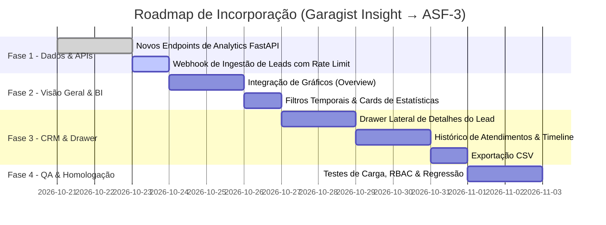

# 🚀 Especificação de Integração: Garagist Insight → ASF-3 (Formula OS)
**Data:** 2026-10-20  
**Versão:** 1.0.0  
**Autor:** Orion (AIOX Master Orchestrator) & @architect  
**Origem:** [garagist-insight](file:///c:/ProjetosMLDB/garagist-insight)  
**Destino:** [ASF-3 (Portal Auto Shopping Formula)](file:///c:/ProjetosMLDB/ASF-3)

---

## 1. Sumário Executivo & Decisão de Arquitetura

**Decisão Estratégica:** Caminho 2 — **Incorporação Nativa no ASF-3**.  
Não forçamos o schema ou frontend do `garagist-insight`. Em vez disso, preservamos a infraestrutura sólida, multi-tenant e robusta do **ASF-3 (Formula OS)** — baseada em **FastAPI + PostgreSQL / SQLite** com prefixo obrigatório **`formulaos_*`** —, absorvendo diretamente:
1. Os algoritmos e agregações de Business Intelligence (BI) de leads.
2. A rica experiência de usuário (UX) de filtros temporais, gráficos e drawer de detalhes do lead.
3. A rota de ingestão de leads com rate limiting e proteção de abuse.

---

## 2. Inventário de Recursos & De-para de Funcionalidades

| Recurso / Módulo | Garagist Insight (Origem) | ASF-3 (`formulaos_*`) | Ação de Incorporação Nativa |
| :--- | :--- | :--- | :--- |
| **Analytics & BI** | Gráficos por Cidade, Pagamento (Troca/Entrada/Financiamento), Marca, Modelo, Garagista; filtros temporais | Apenas funil de estágios (`/api/dashboard/funnel`) e equipe (`/api/dashboard/team`) | **Incorporar no ASF-3:** Nova rota `/api/dashboard/insights` no FastAPI e renderização de gráficos na tela de Visão Geral. |
| **CRM / Detalhe do Lead** | Listagem paginada, ordenação por colunas, drawer lateral (`Sheet`) de histórico, notas com autor, export CSV | Grid simples de CRM sem drawer rico ou exportação CSV | **Incorporar no ASF-3:** Adicionar drawer lateral de lead, timeline de notas de `formulaos_lead_notes` e exportação CSV. |
| **Lojas / Garagistas** | `public.garagistas` (UUID, sem multi-tenancy) | `public.formulaos_stores` (INT, `tenant_id`, métricas, SDR prompt) | **Preservar ASF-3:** As lojas permanecem em `formulaos_stores`. O Garagist é apenas uma loja ou tenant dentro do ASF-3. |
| **Ingestão Externa** | Edge Function `webhook-leads` com rate limiting | Ingestão WhatsApp / rotas internas | **Portar para FastAPI:** Endpoint `/api/webhooks/leads` com validação de payload e rate limiting sliding window. |
| **Controle de Acesso (RBAC)** | `admin` e `cliente` | `master`, `shopping`, `gestor`, `lojista`, `vendedor` | **Preservar ASF-3:** O RBAC do ASF-3 já atende e supera o modelo do Garagist. |

---

## 3. Mapeamento Físico de Dados (Schema Translation)

> [!IMPORTANT]
> No PostgreSQL/Supabase do ASF-3, todas as tabelas possuem o prefixo **`formulaos_`** e chaves primárias numéricas sequenciais (`INTEGER`), mantendo total isolamento multi-tenant.

### 3.1. Leads

```
Garagist Insight (Supabase)          ASF-3 (Postgres / SQLite)
─────────────────────────────────     ─────────────────────────────────
leads.id (UUID)                   →   formulaos_leads.id (INTEGER PK)
leads.nome (TEXT)                 →   formulaos_leads.name (TEXT)
leads.whatsapp (TEXT)             →   formulaos_leads.phone (TEXT)
leads.cidade (TEXT)               →   formulaos_leads.city (TEXT)
leads.carro_desejado (TEXT)       →   formulaos_leads.car_interest (TEXT)
leads.tipo_pagamento (ENUM[])     →   formulaos_leads.payment_preference (TEXT)
leads.status (lead_status)        →   formulaos_leads.stage (TEXT)
leads.garagista_id (UUID)         →   formulaos_leads.store_id (INTEGER FK)
leads.cliente_user_id (UUID)      →   formulaos_leads.assigned_user_id (INTEGER FK)
leads.observacoes (TEXT)          →   formulaos_lead_notes (Tabela filha 1:N)
(Exclusivo ASF-3)                 ←   formulaos_leads.score (INTEGER)
(Exclusivo ASF-3)                 ←   formulaos_leads.origin_id (INTEGER)
(Exclusivo ASF-3)                 ←   formulaos_leads.searched_history_json (TEXT)
```

### 3.2. Histórico de Atendimentos

```
Garagist (lead_history)               ASF-3 (formulaos_lead_notes)
─────────────────────────────────     ─────────────────────────────────
lead_history.id (UUID)            →   formulaos_lead_notes.id (INTEGER PK)
lead_history.lead_id (UUID)       →   formulaos_lead_notes.lead_id (INTEGER FK)
lead_history.descricao (TEXT)     →   formulaos_lead_notes.content (TEXT)
lead_history.tipo (TEXT)          →   formulaos_lead_notes.type (TEXT)
lead_history.created_by (UUID)    →   formulaos_lead_notes.user_id (INTEGER FK)
lead_history.created_at           →   formulaos_lead_notes.created_at
```

---

## 4. Novas Rotas Necessárias no Backend FastAPI (`ASF-3`)

Para suportar os dashboards ricos e operações do Garagist Insight, as seguintes rotas serão adicionadas em backend/routes/dashboard.py:

1. **`GET /api/dashboard/insights`**
   - Agrupamentos analíticos:
     - Leads por cidade (`leads_by_city`)
     - Leads por forma de pagamento (`leads_by_payment`)
     - Leads por marca/veículo (`leads_by_brand` / `leads_by_car`)
     - Leads por loja (`leads_by_store`)
   - Filtros aceitos: `period` (`today`, `7days`, `30days`, `thisMonth`, `lastMonth`, `custom`), `start_date`, `end_date`, `store_id`.

2. **`GET /api/leads/export.csv`**
   - Exportação em formato CSV com filtros aplicados (compatível com a lógica de `csvUtils.ts` do Garagist).

3. **`POST /api/webhooks/leads`**
   - Endpoint de ingestão externa com rate limiting e validação rigorosa (portado de `webhook-leads/index.ts`).

---

## 5. Estratégia de Frontend para o ASF-3

O ASF-3 adota frontend sem build (**Vanilla JS** com arquitetura moderna e componentes modulares).
Para incorporar a UX do Garagist Insight:

1. **Biblioteca Gráfica Leve:**
   - Adicionar uma biblioteca leve e performática via CDN/Assets (ex: **Chart.js** ou **ApexCharts**) no index.html para desenhar os gráficos analíticos da Visão Geral (Donut de Pagamentos, Barras por Cidade e Top Marcas).
2. **Drawer de Detalhes do Lead (`LeadSheet`):**
   - Portar o modal/drawer de detalhes com timeline de notas, histórico de atendimentos e atalhos rápidos (`wa.me` para WhatsApp, ligação, troca rápida de status).
3. **Filtro de Períodos:**
   - Componente de seleção de período (Hoje, 7 dias, 30 dias, Mês Atual) integrado ao seletor de datas nativo.

---

## 6. Roadmap de Implementação em 4 Fases



---

## 7. Decisões Arquiteturais Chave (ADR)

1. **ADR-01: Backend Unificado em FastAPI / SQLite**
   - *Decisão:* Não manter dois backends. Todas as APIs e regras de negócio do Garagist migram para o FastAPI existente do ASF-3.
2. **ADR-02: Preservação do RBAC do ASF-3**
   - *Decisão:* Usar os papéis existentes do ASF-3 (`master`, `shopping`, `lojista`, `gestor`, `vendedor`), que já cobrem com sobra os papéis `admin` e `cliente` do Garagist.
3. **ADR-03: Modularidade Visual no Vanilla JS**
   - *Decisão:* Manter o frontend do ASF-3 leve e rápido sem pipeline de build complexo, incorporando os componentes de gráficos e o drawer de lead de forma modular no `app.js` e `styles.css`.
